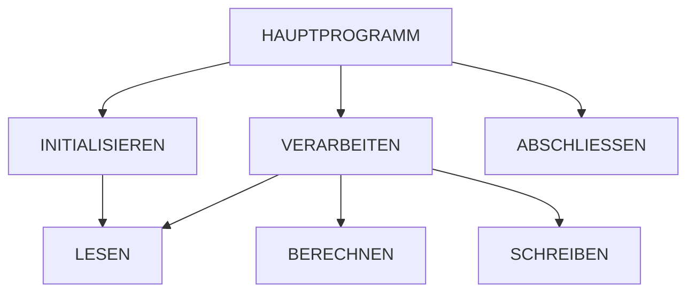

# COBOL-Assistent: Legacy-Code verstehen, dokumentieren und absichern


Viele Kernsysteme in Verwaltung, Versicherung und Banken laufen noch auf COBOL. Wer sie weiterentwickeln oder modernisieren soll, muss sie zuerst verstehen.
Dieses Werkzeug liest COBOL-Quelltext ein und liefert:

1. **Strukturanalyse**: Programmname, Dateien, Datenfelder mit PIC-Klauseln, Absätze, PERFORM- und CALL-Beziehungen, geänderte Felder, zyklomatische Komplexität.
2. **Erklärung in Alltagssprache**: über ein Sprachmodell, das die Strukturanalyse als Kontext bekommt, oder regelbasiert ohne Sprachmodell.
3. **Technische Dokumentation** als Markdown, inklusive **Aufrufgraph** (Mermaid).
4. **Testfälle** aus den Grenzwerten der PIC-Klauseln, um das Verhalten vor einer Modernisierung festzuhalten.
5. **Hinweise** auf Risiken: GO TO, nie aufgerufene Absätze, ungenutzte Felder, fehlendes Programmende.

## Beispiel

`samples/RENTBER.cbl` ist ein bewusst vereinfachtes Demoprogramm (keine echte Rentenformel). Ergebnis der Analyse:



Abgeleitete Testfälle (Auszug):

| Feld | Eingabe | Grund |
| --- | --- | --- |
| VERS-ENTGELTPUNKTE | 999.99 | obere Grenze von PIC 9(3)V99 |
| VERS-ZUGANGSFAKTOR | 0 | untere Grenze, Sonderfall im Programm |
| VERSICHERTE | leere Datei | Dateiende sofort erreicht |

## Architektur

| Projekt | Inhalt |
| --- | --- |
| `src/CobolAssistant.Core` | Parser (festes und freies Format), PIC-Auswertung, Dokumentation, Aufrufgraph, Testfälle, Erklärung |
| `src/CobolAssistant.Api` | ASP.NET Core Minimal API und Weboberfläche |
| `tests/CobolAssistant.Tests` | Unit-Tests und End-to-End-Tests (xUnit) |

### Designentscheidungen

- **Erst Fakten, dann Sprachmodell.** Der deterministische Parser liefert die Struktur; das Sprachmodell formuliert nur und soll Vermutungen kennzeichnen. So bleiben Erklärungen überprüfbar.
- **Fehlertolerant statt vollständig.** Der Parser ersetzt keinen Compiler, erkennt aber die Strukturen, die für Verständnis und Tests wichtig sind, auch bei unvollständigem Code.
- **Anbieterunabhängig.** OpenAI-kompatible Schnittstelle, auch lokal mit Ollama nutzbar, damit Quelltext das Haus nicht verlassen muss.

## Starten

```bash
dotnet run --project src/CobolAssistant.Api
```

Oberfläche unter `http://localhost:5000`, dort "Beispiel laden" und "Analysieren".

Mit Sprachmodell:

```bash
export Llm__BaseUrl=http://localhost:11434/v1   # z. B. Ollama, lokal
export Llm__Model=llama3.1
```

## Tests

```bash
dotnet test tests/CobolAssistant.Tests
```

## Grenzen

- COPY-Strecken (Copybooks) werden nicht aufgelöst.
- REDEFINES und OCCURS werden noch nicht ausgewertet.
- Die Testfälle beschreiben Eingaben und Erwartungen; ausführbare Tests für einen COBOL-Compiler werden noch nicht erzeugt.
